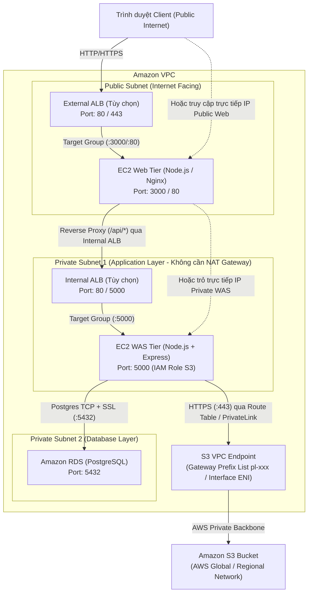

# Đặc Tả 01: Kiến Trúc Hệ Thống, Load Balancer & Luồng Dữ Liệu (Architecture & Flow)

## 1. Sơ Đồ Kiến Trúc Tổng Thể (3-Tier + Load Balancers + S3 VPC Endpoint)

Mô hình triển khai chuẩn trên AWS VPC hỗ trợ kết nối trực tiếp qua IP hoặc thông qua cặp **External ALB + Internal ALB**, kết hợp **Amazon RDS** và **Amazon S3 VPC Endpoint**:



---

## 2. Chi Tiết Luồng Dữ Liệu & Tích Hợp Load Balancer

### 2.1. Thay thế IP của Web và WAS bằng AWS Load Balancer (ALB / NLB)

Hệ thống được thiết kế không phụ thuộc cứng vào IP tĩnh (Stateless & Origin-aware), cho phép dùng DNS của Load Balancer ở cả 2 tầng:

1. **Tầng Web (Thay IP Public EC2 Web bằng External ALB)**:
   - Khi người dùng truy cập qua tên miền của **External ALB** (ví dụ: `http://web-alb-123456.ap-southeast-1.elb.amazonaws.com`), trình duyệt tự động lấy `window.location.origin` làm gốc gọi API (`/api/items`, `/api/s3/*`).
   - Target Group của External ALB sử dụng Health Check Path `/web-healthz` (hoặc `/healthz`, `/`) luôn nhận phản hồi HTTP `200 OK` tức thì.

2. **Tầng WAS (Thay IP Private EC2 WAS bằng Internal ALB)**:
   - Trong tệp `web/.env` trên máy EC2 Web, biến `WAS_API_URL` chấp nhận bất kỳ URL HTTP/HTTPS hợp lệ nào, bao gồm cả **DNS Name của Internal ALB/NLB**:
     ```env
     WAS_API_URL=http://internal-was-alb-123456789.ap-southeast-1.elb.amazonaws.com:5000
     ```
     *(Nếu Listener trên Internal ALB lắng nghe ở cổng `80` và chuyển tiếp vào Target Group cổng `5000`, chỉ cần khai báo `WAS_API_URL=http://internal-was-alb-123456789.ap-southeast-1.elb.amazonaws.com`)*.
   - Target Group của Internal ALB sử dụng Health Check Path `/healthz` hoặc `/ping` trên cổng `5000` của WAS.

3. **Mô hình 1 ALB dùng Path-based Routing (Gộp chung trên 1 ALB)**:
   - Nếu chỉ dùng 1 Application Load Balancer duy nhất đứng trước cả Web và WAS:
     - Listener Rule 1: Path `/api/*` và `/health*` $\rightarrow$ Forward vào **Target Group WAS (Port 5000)**.
     - Listener Rule Default: Tất cả request còn lại (`/*`) $\rightarrow$ Forward vào **Target Group Web (Port 3000/80)**.

---

### 2.2. Luồng Kết Nối Amazon S3 Qua VPC Endpoint (Lab 2)

1. **Client thao tác trên Tab S3**: Người dùng xem cây thư mục S3 (`S3 Tree View`), tạo thư mục, tạo/sửa file hoặc upload file trên giao diện Web.
2. **Web Reverse Proxy**: `web/server.js` chuyển tiếp các request `/api/s3/*` sang tầng WAS (`WAS_API_URL`).
3. **WAS gọi S3 qua VPC Endpoint**:
   - Máy chủ EC2 WAS nằm trong **Private Subnet hoàn toàn cô lập** (không có Internet Gateway, không cần NAT Gateway).
   - Khi dùng **S3 Gateway VPC Endpoint**: WAS phân giải DNS `bucket.s3.<region>.amazonaws.com` ra dải IP S3 của Region, và Route Table của Private Subnet định tuyến gói tin HTTPS (cổng 443) qua `vpce-xxx` dựa trên Prefix List (`pl-xxxxxx`).
   - Khi dùng **S3 Interface VPC Endpoint (PrivateLink)**: DNS trả về địa chỉ IP nội bộ trong VPC (`10.x.x.x`) của Endpoint ENI (nếu bật Private DNS) hoặc gọi qua `S3_ENDPOINT_URL` tùy chỉnh.

---

## 3. Quy Tắc Tường Lửa & Security Groups (Network Ports)

| Security Group | Chiều (Direction) | Giao thức & Cổng | Nguồn / Đích (Source / Destination) | Mục đích |
| :--- | :--- | :--- | :--- | :--- |
| **SG-Ext-ALB** | Inbound | TCP 80 / 443 | `0.0.0.0/0` (Internet) | Người dùng truy cập qua External ALB. |
| **SG-Web** | Inbound | TCP 80 / 3000 | `SG-Ext-ALB` (hoặc `0.0.0.0/0`) | Nhận traffic từ External ALB hoặc trực tiếp từ trình duyệt. |
| **SG-Web** | Outbound | TCP 80 / 5000 | `SG-Int-ALB` (hoặc `SG-WAS`) | Web Server kết nối Reverse Proxy tới Internal ALB hoặc WAS. |
| **SG-Int-ALB** | Inbound | TCP 80 / 5000 | `SG-Web` | Internal ALB nhận traffic từ tầng Web. |
| **SG-WAS** | Inbound | TCP 5000 | `SG-Int-ALB` (hoặc `SG-Web`) | Chỉ nhận traffic API từ Internal ALB hoặc máy Web. |
| **SG-WAS** | Outbound | TCP 5432 | `SG-RDS` | WAS kết nối tới cơ sở dữ liệu PostgreSQL. |
| **SG-WAS** | Outbound | TCP 443 | `pl-xxxxxx` (S3 Prefix List) / `SG-VPCE` | WAS kết nối HTTPS tới Amazon S3 qua VPC Endpoint. |
| **SG-RDS** | Inbound | TCP 5432 | `SG-WAS` | Chỉ cho phép máy WAS kết nối vào cơ sở dữ liệu. |

