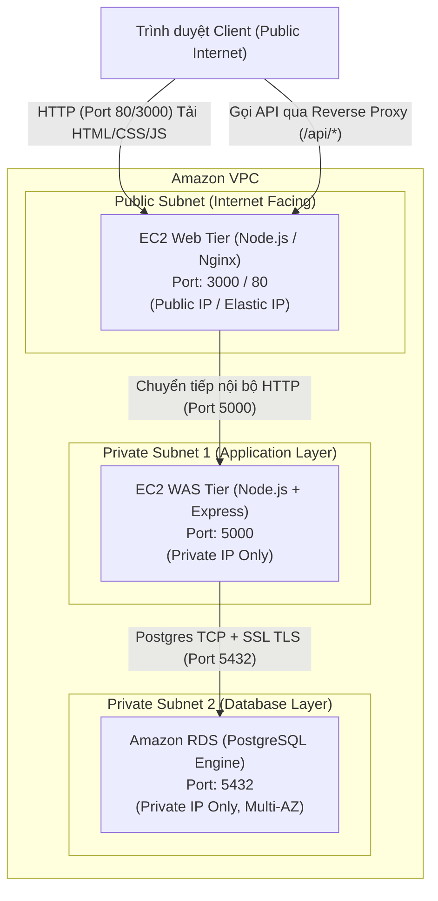

# Đặc Tả 01: Kiến Trúc Hệ Thống & Luồng Dữ Liệu (Architecture & Flow)

## 1. Sơ Đồ Kiến Trúc Tổng Thể (System Architecture)

Mô hình triển khai chuẩn trên AWS VPC sử dụng 2 máy chủ EC2 và 1 cơ sở dữ liệu AWS RDS quản lý:

---

## 2. Chi Tiết Luồng Dữ Liệu (Data Flows)

Hệ thống hỗ trợ 2 chế độ định tuyến lưu lượng dữ liệu (Traffic Routing Modes):

### Chế độ 1: Reverse Proxy Nội Bộ (Khuyên dùng - Mặc định)
Đây là chế độ bảo mật cao nhất, bảo vệ tầng WAS hoàn toàn bên trong mạng nội bộ mà không cần gán Public IP cho máy WAS.

1. **Client tải giao diện**: Trình duyệt người dùng gửi HTTP request tới IP Public của máy `EC2 Web` tại cổng `3000` (hoặc `80` qua Nginx). Máy Web trả về file tĩnh `index.html`, `style.css`, `app.js` và file sinh động `config.js`.
2. **Client gọi API**: Giao diện Javascript (`app.js`) gửi request tới cùng domain/origin với tiền tố `/api/...` hoặc `/health`.
3. **Web Server chuyển tiếp**: Module `server.js` trên tầng Web phát hiện request bắt đầu bằng `/api/` hoặc `/health`, tự động dùng HTTP client nội bộ để forward request này tới địa chỉ IP nội bộ của tầng WAS (`WAS_API_URL`, ví dụ: `http://10.0.x.x:5000`).
4. **Xử lý tại WAS**: WAS nhận request, truy vấn hoặc cập nhật dữ liệu trên AWS RDS qua cổng `5432` bằng kết nối mã hóa SSL.
5. **Trả kết quả**: WAS trả JSON về Web Server, Web Server trả ngược về Trình duyệt của Client. Không xảy ra lỗi CORS vì Client chỉ giao tiếp duy nhất với Web Server.

### Chế độ 2: Trực Tiếp / Qua AWS Application Load Balancer (ALB)
Áp dụng khi hệ thống có thêm một Application Load Balancer công khai đứng trước cả Web và WAS.
- Trình duyệt gọi trực tiếp API tới WAS endpoint (hoặc qua path rule của ALB như `/api/*` định tuyến vào Target Group của WAS).
- WAS đã được kích hoạt sẵn middleware `cors()` để tiếp nhận các truy vấn cross-origin từ các domain được ủy quyền.

---

## 3. Quy Tắc Tường Lửa & Security Groups (Network Ports)

Để hệ thống hoạt động an toàn theo nguyên tắc đặc quyền tối thiểu (Least Privilege), các Security Group cần được cấu hình như sau:

| Security Group | Chiều (Direction) | Giao thức & Cổng | Nguồn / Đích (Source / Destination) | Mục đích |
| :--- | :--- | :--- | :--- | :--- |
| **SG-Web** | Inbound | TCP 80 / 443 / 3000 | `0.0.0.0/0` (Internet) | Người dùng truy cập giao diện Web. |
| **SG-Web** | Outbound | TCP 5000 | `SG-WAS` | Web Server kết nối Reverse Proxy tới WAS. |
| **SG-WAS** | Inbound | TCP 5000 | `SG-Web` (hoặc `SG-ALB`) | Chỉ nhận traffic API từ tầng Web / Load Balancer. Không mở ra Internet. |
| **SG-WAS** | Outbound | TCP 5432 | `SG-RDS` | WAS kết nối tới cơ sở dữ liệu PostgreSQL. |
| **SG-RDS** | Inbound | TCP 5432 | `SG-WAS` | Chỉ cho phép duy nhất máy WAS kết nối vào cơ sở dữ liệu. |

