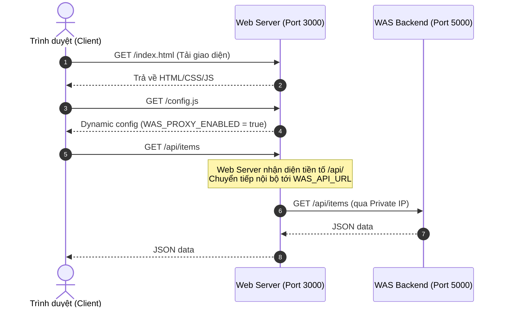

# Đặc Tả 03: Tầng Trình Diễn Frontend (Web Tier Specification)

## 1. Tổng Quan Tầng Web

- **Mã nguồn**: `web/`
- **Máy chủ Web**: Node.js core `http` module (`web/server.js`) hoặc tùy chọn Nginx (`web/nginx.conf.example`).
- **Cổng dịch vụ mặc định**: `3000` (cấu hình qua biến `PORT`).
- **Đặc điểm nổi bật**:
  - **Zero External Dependencies**: Không yêu cầu cài đặt bất kỳ thư viện npm nào từ bên ngoài (`node_modules` hoàn toàn rỗng hoặc không cần thiết cho `web/`).
  - **Dung lượng bộ nhớ RAM cực thấp**: Chiếm dụng **dưới 20MB RAM** khi hoạt động.
  - **Tích hợp sẵn Reverse Proxy**: Tự động đóng vai trò cổng trung gian chuyển tiếp các truy vấn API tới tầng WAS.

---

## 2. Các Thành Phần & Tệp Tin

| Tệp tin | Vai trò |
| :--- | :--- |
| `web/index.html` | Cấu trúc giao diện người dùng đơn trang (Single Page Application - SPA), bao gồm thanh thông báo trạng thái kết nối, form nhập liệu, ô tìm kiếm và bảng hiển thị danh sách bản ghi. |
| `web/style.css` | Phong cách thiết kế hiện đại (Dark Glassmorphism, hiệu ứng blur, gradient, responsive đa kích thước màn hình). |
| `web/app.js` | Logic client: Khởi chạy polling kiểm tra sức khỏe hệ thống, thực hiện các cuộc gọi `fetch()` để lấy danh sách, tạo mới, sửa và xóa bản ghi, tự động điều hướng giữa chế độ proxy và trực tiếp. |
| `web/server.js` | Máy chủ HTTP Node.js: Phục vụ các tài nguyên tĩnh với MIME type chính xác, sinh tệp `/config.js` động và thực hiện Reverse Proxy. |
| `web/nginx.conf.example` | File cấu hình tham khảo khi người dùng muốn sử dụng Nginx thay thế cho `web/server.js`. |

---

## 3. Cơ Chế Reverse Proxy Tích Hợp Sẵn (Built-in Reverse Proxy)

Khi biến môi trường `WAS_API_URL` được định cấu hình trên máy Web (ví dụ: `http://<WAS_PRIVATE_IP>:5000`):



### Xử lý kỹ thuật trong `web/server.js`:
- Khi có request gửi đến với đường dẫn bắt đầu bằng `/api/` hoặc `/health` hoặc `/healthz`:
  - `web/server.js` đọc biến `WAS_API_URL`.
  - Thiết lập kết nối HTTP client nội bộ tới địa chỉ WAS mục tiêu.
  - Chuyển tiếp nguyên vẹn: HTTP Method, Headers, và Data Streams (Stream-based piping) từ Client tới WAS và ngược lại.
  - Thiết lập timeout bảo vệ (5000ms), trả về mã `504 Gateway Timeout` hoặc `502 Bad Gateway` nếu máy chủ WAS không phản hồi.

---

## 4. Cơ Chế Sinh Cấu Hình Động (`/config.js`)

Khi trình duyệt yêu cầu tệp `/config.js`, máy chủ Web không đọc từ tệp tĩnh mà sinh động chuỗi JavaScript trả về với header `Cache-Control: no-cache`:

```javascript
window.APP_CONFIG = {
  DEFAULT_API_URL: window.location.origin,
  WAS_PROXY_ENABLED: true, // hoặc false nếu không truyền WAS_API_URL
  WAS_TARGET_URL: "http://<WAS_PRIVATE_IP>:5000"
};
```
Nhờ cơ chế này, phía client Javascript (`web/app.js`) luôn nhận biết chính xác liệu hệ thống đang chạy qua chế độ Reverse Proxy nội bộ hay gọi trực tiếp, không bao giờ cần phải hardcode địa chỉ IP trong mã nguồn frontend.

